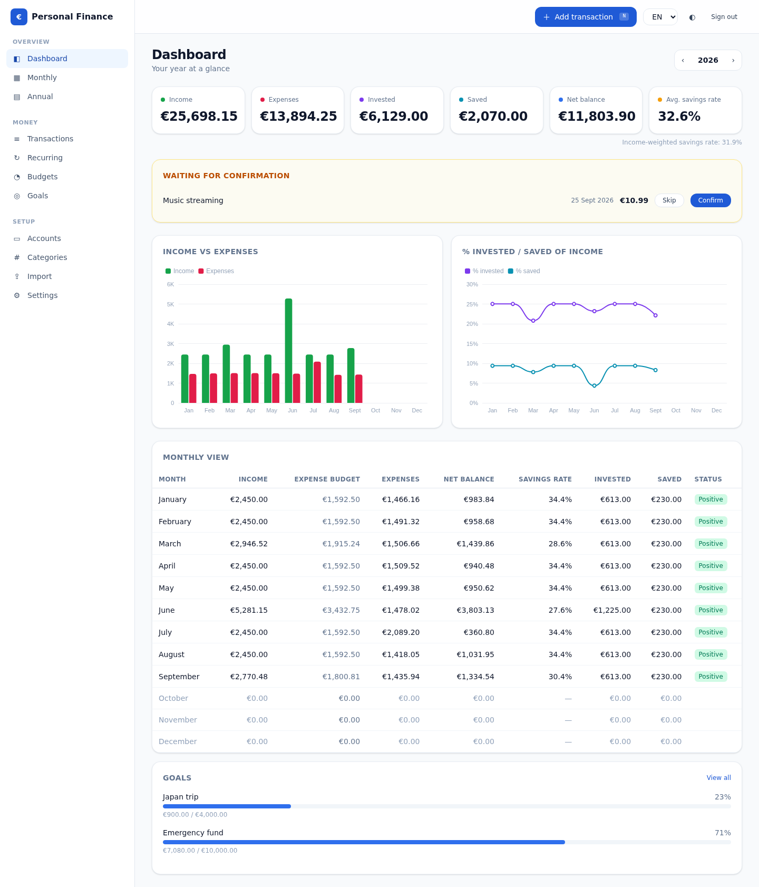
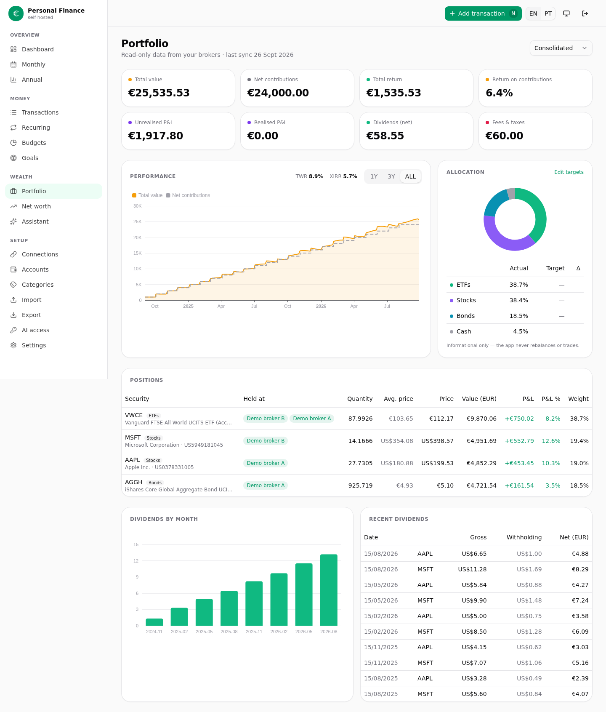
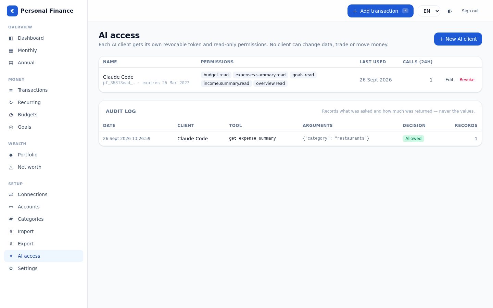
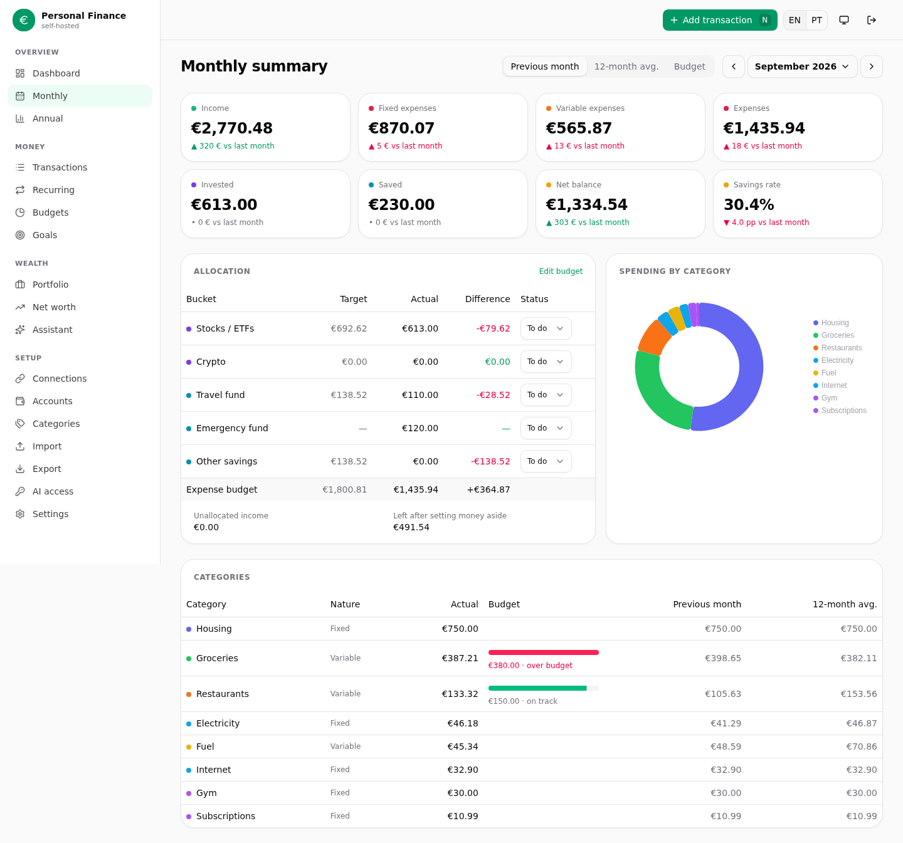
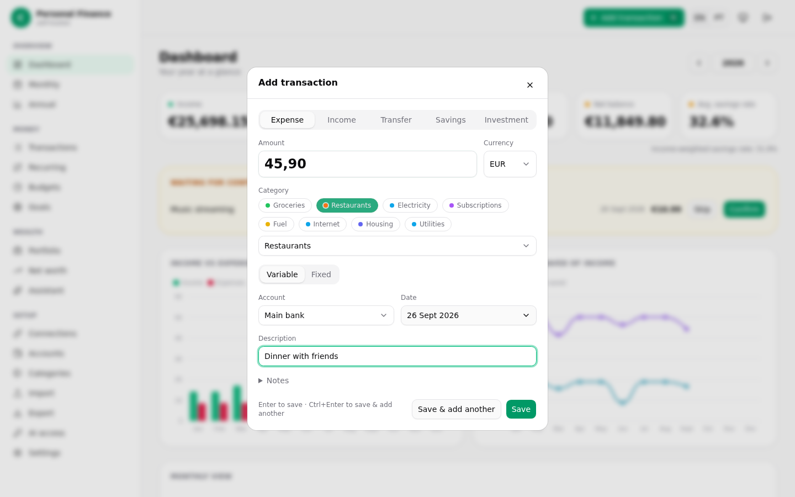
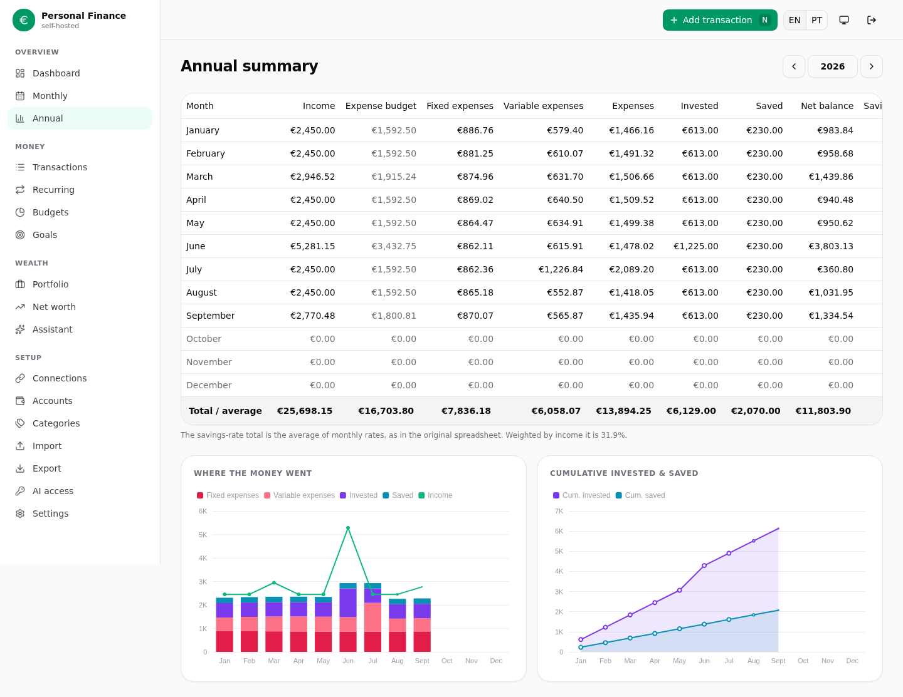
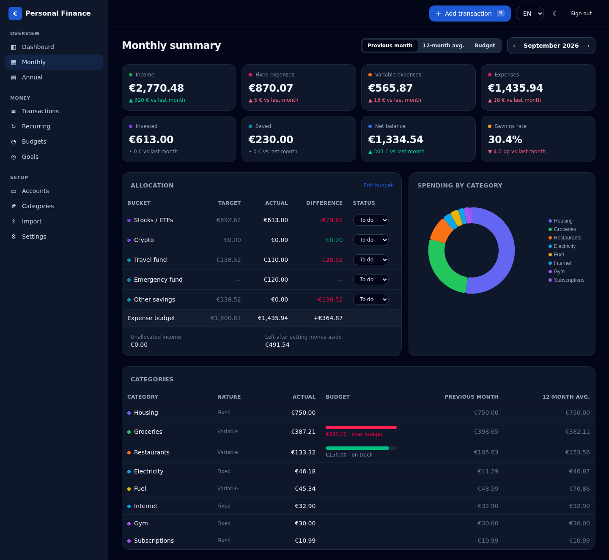

# Personal Finance

A self-hosted personal finance and investment manager: one transaction ledger, budgets, loans and goals,
read-only Trading 212 / Interactive Brokers / Binance sync, Excel and CSV export, and an optional,
permission-gated AI assistant. Your data stays on your own computer or your own server.

[](https://github.com/joaoguimaraespro/personal-finance/releases/latest)
[](https://github.com/joaoguimaraespro/personal-finance/actions/workflows/ci.yml)
[](https://github.com/joaoguimaraespro/personal-finance/actions/workflows/codeql.yml)


[](LICENSE)



> All screenshots use fictitious demo data generated by the end-to-end test.

## Install

| I want… | Use |
|---|---|
| The app on one Windows PC or Mac, nothing else to set up | **[Desktop app](docs/desktop-app.md)**: download the installer from [Releases](https://github.com/joaoguimaraespro/personal-finance/releases/latest) |
| To try it quickly with Docker | `scripts/local-up.ps1` / `scripts/local-up.sh` ([below](#try-it-with-docker)) |
| Docker on an everyday computer, with phone access and encrypted daily backups | [Windows](docs/windows.md) · [macOS or Linux](docs/desktop.md) |
| A 24/7 home server reachable only over a VPN | [`server-deploy.sh`](docs/deployment.md) |

### Desktop app (Windows or macOS, no Docker)

Download `PersonalFinance-Setup-<version>-x64.exe` (Windows) or the `.dmg` for your Mac (Apple Silicon `arm64`,
Intel `x64`) from the [latest release](https://github.com/joaoguimaraespro/personal-finance/releases/latest),
install and open **Personal Finance**. It brings its own database, runs only while its window is open and listens on
this computer only. The installers are not code-signed yet, so Windows and macOS warn on the first run: the steps
are in [docs/desktop-app.md](docs/desktop-app.md#first-run). There is no Linux installer yet; use Docker there.

### Try it with Docker

```powershell
git clone https://github.com/joaoguimaraespro/personal-finance.git
cd personal-finance
.\scripts\local-up.ps1          # Windows (Docker Desktop)
./scripts/local-up.sh            # macOS / Linux
```

Open **https://localhost:8443**, accept the local certificate, create the owner with the printed setup token,
enrol an authenticator app, and explore. *Connections → Demo broker* adds a fictitious portfolio.
Stop with the command the script prints (add `-v` to wipe the local database).

### Home server

```bash
sudo deploy/scripts/server-deploy.sh --backup-recipient age1…   # idempotent; re-run to upgrade
```

One command creates an isolated `finance` user with its own rootless Docker, generates secrets, starts the
stack on loopback and publishes it on the tailnet only (`tailscale serve`, HTTPS on :8443), with daily
encrypted backups. Details in [docs/deployment.md](docs/deployment.md) and the
[disaster-recovery runbook](docs/disaster-recovery.md).

## Features

| Area | What it does |
|---|---|
| **Transactions** | One ledger for income, fixed and variable expenses, transfers, savings and investment contributions, grouped by day. Split a movement over several categories, record refunds, multiple currencies with the EUR amount kept. Every change is audited. |
| **Quick add** | Press <kbd>N</kbd> anywhere: amount first, recent categories as chips, remembered account, <kbd>Enter</kbd> to save, <kbd>Ctrl</kbd>+<kbd>Enter</kbd> to save and add another. |
| **Accounts** | Banks, savings, cards and brokers grouped by institution. Savings interest (TANB) with daily accrual, restricted-use balances such as meal and benefit cards. |
| **Budgets** | Split income by percentage, fixed amount or "what is left" into expenses, savings and investments, with per-category limits. Changing the split never rewrites past months. The monthly checklist shows what was already set aside — broker deposits included — and records the rest in one click. |
| **Recurring** | Salary, rent and subscriptions every N days, monthly or yearly on a date. They are proposals: nothing is booked until you confirm, edit or skip; bills that vary are proposed at their recent average. |
| **Reports** | Month vs previous month, 12-month average and budget; the year at a glance; category breakdown and trends. All figures are calculated on the server with exact decimals. |
| **Investments** | Read-only sync from Trading 212, Interactive Brokers and Binance (spot and Simple Earn); crypto in other wallets entered by hand. Real cost basis in euros, fees included. Portfolio by broker and wallet, allocation vs target, dividends with withholding tax, today's change and returns over 1M / YTD / 1Y / all time (TWR and XIRR). [Setup](docs/broker-integrations.md). |
| **Net worth** | Every account, holding and loan over time, reconstructed month by month even before you started using the app. |
| **Loans** | Mortgage, car or personal loans, fixed or variable: amortisation plan with commission, stamp duty and insurance, rate revisions, early repayments and a simulator. Instalments are proposed for booking. |
| **Sharing** | Split a cost with friends or flatmates — a streaming plan, the flat's bills, a supermarket run: the account pays it all, your spending counts only your part, and each person owes theirs until they pay you back. Who owes what, and since when, in one place. |
| **Goals** | Emergency fund, trips, a house deposit — progress from the savings account a goal follows, and the monthly amount still needed. |
| **Import / export** | .xlsx with native charts, CSV per dataset, and a complete JSON archive that restores into any install. "Start fresh" clears the data and keeps connections and categories. |
| **AI (optional)** | An MCP server for Claude, ChatGPT or local models and an in-app assistant, behind a policy gateway: per-client revocable tokens, explicit permissions, minimal answers, audit. Read-only by default; opt-in writes with a 30-day recycle bin. [Details](docs/ai.md). |
| **Everywhere** | Desktop app for Windows and macOS, or Docker on a computer or home server; phone layout; English and Portuguese (Portugal); light and dark themes. |

<table>
<tr>
<td></td>
<td></td>
</tr>
<tr>
<td></td>
<td></td>
</tr>
<tr>
<td></td>
<td></td>
</tr>
</table>

## Security at a glance

- Never on the public internet: loopback only, plus Tailscale for the server install.
- Single owner; TOTP MFA mandatory on server and Docker installs (optional in the single-computer desktop app).
- Strict cookies, anti-forgery tokens, strict CSP, rate limiting; IBANs encrypted at rest.
- Least-privilege database roles, hardened non-root containers, age-encrypted backups with a drilled restore.
- Logs and traces carry no amounts, descriptions or query strings.

Threat model and controls: [docs/security.md](docs/security.md). Report vulnerabilities privately: [SECURITY.md](SECURITY.md).

## Development

```bash
docker compose -f deploy/compose.dev.yml up -d          # PostgreSQL on 127.0.0.1:55432
dotnet run --project backend/src/Host.Api                  # API on http://localhost:5080 (migrates on start)
cd web && npm ci && npm start                              # UI on http://localhost:4200
```

Open the UI, create the owner with the dev setup token from `backend/src/Host.Api/appsettings.Development.json`,
enrol an authenticator app, and press <kbd>N</kbd>.

```bash
cd backend && dotnet test         # unit, architecture and integration tests (Docker required for integration)
cd web && npm test                # frontend unit tests
```

Test suites, conventions and how to propose a change: [CONTRIBUTING.md](CONTRIBUTING.md).

## Documentation

- Install: [desktop app](docs/desktop-app.md) · [Windows with Docker](docs/windows.md) ·
  [macOS or Linux with Docker](docs/desktop.md) · [home server](docs/deployment.md) ·
  [disaster recovery](docs/disaster-recovery.md)
- Use: [broker connections](docs/broker-integrations.md) · [AI access and MCP](docs/ai.md)
- Design: [architecture](docs/architecture.md) · [security](docs/security.md) · [decision records](docs/adr) ·
  [workbook analysis](docs/excel-migration.md)
- Project: [changelog](CHANGELOG.md) · [contributing](CONTRIBUTING.md) · [support](SUPPORT.md) ·
  [code of conduct](CODE_OF_CONDUCT.md) · [releasing](docs/releasing.md)

## Tech

.NET 10 · ASP.NET Core minimal APIs · EF Core 10 + Npgsql · FluentValidation · ClosedXML ·
OpenTelemetry · Angular 22 (zoneless, signals) · spartan/ui (shadcn-style, Angular CDK) · Tailwind CSS 4 ·
ECharts · lucide icons · ngx-translate ·
PostgreSQL 17 · Caddy · Docker Compose · Tailscale · xUnit v3 · Testcontainers · Playwright

## License

[MIT](LICENSE)

Trading 212, Interactive Brokers, Binance, Coinbase, Kraken, Ledger, Trezor and SafePal names and logos, and the company logos shown next to holdings, are trademarks
of their respective owners. They are used only to identify the broker a connection belongs to, or the exchange
or wallet a hand-entered crypto wallet is named after; this project is not affiliated with or endorsed by any of
them. The MIT license does not cover them (`web/public/brokers/`, `web/public/wallets/`).

Coin icons come from [cryptocurrency-icons](https://github.com/spothq/cryptocurrency-icons) (CC0-1.0), served
as static files from the npm package.
