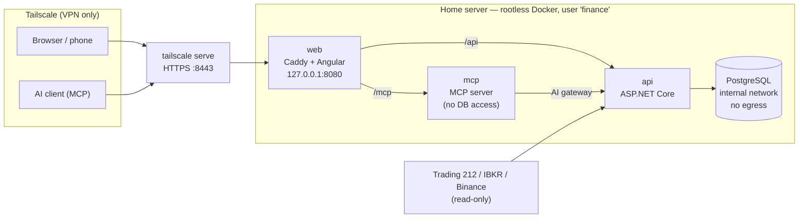

# Personal Finance

A self-hosted personal finance and investment manager: one transaction ledger, budgets, loans and goals,
read-only Trading 212 / Interactive Brokers / Binance sync, Excel and CSV export, and an optional,
permission-gated AI assistant. Your data stays on your own computer or your own server.

[](https://github.com/joaoguimaraespro/personal-finance/releases/latest)
[](https://github.com/joaoguimaraespro/personal-finance/actions/workflows/ci.yml)
[](https://github.com/joaoguimaraespro/personal-finance/actions/workflows/codeql.yml)


[](LICENSE)


> All screenshots use fictitious demo data generated by the end-to-end test.

## Install

| I want… | Use |
|---|---|
| The app on one Windows PC or Mac, nothing else to set up | **[Desktop app](docs/desktop-app.md)**: download the installer from [Releases](https://github.com/joaoguimaraespro/personal-finance/releases/latest) |
| To try it quickly with Docker | `scripts/local-up.ps1` / `scripts/local-up.sh` ([below](#try-it-with-docker)) |
| Docker on an everyday computer, with phone access and encrypted daily backups | [Windows](docs/windows.md) · [macOS or Linux](docs/desktop.md) |
| A 24/7 home server reachable only over a VPN | [`server-deploy.sh`](docs/deployment.md) |

### Desktop app (Windows or macOS, no Docker)

Download `PersonalFinance-Setup-<version>-x64.exe` (Windows) or the `.dmg` for your Mac (Apple Silicon `arm64`,
Intel `x64`) from the [latest release](https://github.com/joaoguimaraespro/personal-finance/releases/latest),
install and open **Personal Finance**. It brings its own database, runs only while its window is open and listens on
this computer only. The installers are not code-signed yet, so Windows and macOS warn on the first run: the steps
are in [docs/desktop-app.md](docs/desktop-app.md#first-run). There is no Linux installer yet; use Docker there.

### Try it with Docker

```powershell
git clone https://github.com/joaoguimaraespro/personal-finance.git
cd personal-finance
.\scripts\local-up.ps1          # Windows (Docker Desktop)
./scripts/local-up.sh            # macOS / Linux
```

Open **https://localhost:8443**, accept the local certificate, create the owner with the printed setup token,
enrol an authenticator app, and explore. *Connections → Demo broker* adds a fictitious portfolio.
Stop with the command the script prints (add `-v` to wipe the local database).

### Home server

```bash
sudo deploy/scripts/server-deploy.sh --backup-recipient age1…   # idempotent; re-run to upgrade
```

One command creates an isolated `finance` user with its own rootless Docker, generates secrets, starts the
stack on loopback and publishes it on the tailnet only (`tailscale serve`, HTTPS on :8443), with daily
encrypted backups. Details in [docs/deployment.md](docs/deployment.md) and the
[disaster-recovery runbook](docs/disaster-recovery.md).

## Features

| Area | What it does |
|---|---|
| **Ledger** | One transaction table replaces twelve month sheets. Income, expenses (fixed/variable), transfers, savings, investment contributions. Multi-currency with original + EUR amounts. Provenance on every row (manual, recurring, Excel, CSV, broker). Soft delete and an append-only audit trail. |
| **Quick add** | Press <kbd>N</kbd> anywhere: amount first, recent categories as chips, remembered account, <kbd>Enter</kbd> to save, <kbd>Ctrl</kbd>+<kbd>Enter</kbd> to save and add another. |
| **Budgets** | Versioned by month (changing the split never rewrites past months). Percent of income, fixed EUR, or "remainder" — the spreadsheet's `1 − investments − savings`. Per-category limits (e.g. Restaurants €150). The monthly allocation works like recurring items: each bucket shows done / partial from what was set aside — including deposits synced at a linked broker — and one click records the rest. |
| **Reports** | Monthly summary vs previous month / 12-month average / budget, annual summary (every column of the old "Resumo Anual"), category breakdown, trends. All figures computed on the server with `decimal`. |
| **Recurring** | Salary, rent, subscriptions propose *expected* transactions; nothing is booked until you confirm, edit or skip. |
| **Loans** | Mortgage, car or personal loan terms (fixed, or index + spread with revisions): instalment, interest vs capital, what is left, end date, full plan and an early-repayment simulator (shorten the term or lower the instalment). The debt in net worth follows the plan. |
| **Goals** | Emergency fund, trips, house deposit — progress from a savings account the goal follows (its balance, interest included) or from savings linked to it; monthly amount needed. Investments never count towards goals. |
| **Investments** | Read-only sync from Trading 212 (Public API + CSV), Interactive Brokers (Flex Web Service) and Binance (spot + Simple Earn, with Earn rewards as income; the key is checked to be read-only). Consolidated portfolio by ISIN with per-broker holdings, allocation vs target, dividends with withholding tax, TWR and XIRR, net worth history. [Setup](docs/broker-integrations.md). |
| **Import / export** | Real .xlsx (Excel tables, native charts), CSV per dataset (Excel-PT dialect), and the app's complete JSON archive, which restores into any install (desktop, PC or server). "Start fresh" clears the finance data and keeps connections and categories. |
| **AI** | MCP server for Claude Code / ChatGPT / local models and an optional in-app assistant, both behind a policy gateway: per-client revocable tokens, explicit scopes, question-specific minimal answers, untrusted-text wrapping, audit. Read-only by default; opt-in, audited write tools with a 30-day recycle bin. [Details](docs/ai.md). |
| **Security** | Single owner, TOTP MFA (mandatory on server installs), CSRF protection, rate limiting, encrypted identifiers, least-privilege database roles, loopback/VPN-only exposure, encrypted backups. |
| **i18n** | English and European Portuguese, light/dark theme. |

<table>
<tr>
<td></td>
<td></td>
</tr>
<tr>
<td></td>
<td></td>
</tr>
<tr>
<td></td>
<td></td>
</tr>
</table>

## Why

It started as a replacement for a monthly Excel workbook: every month a copy of the last sheet, formulas duplicated
twelve times, allocation changes silently rewriting history, investments spread over several broker apps. The app
keeps that workflow — fixed vs variable expenses, a percentage split of income into investments / savings /
spending, a monthly checklist — and rebuilds it on a database.

## Architecture

A modular monolith: one deployable API, modules with their own domain, application and persistence
layers, sharing one PostgreSQL database in separate schemas. The server install:



The desktop app runs the same API and web app in one process with an embedded PostgreSQL
([ADR-0010](docs/adr/0010-desktop-app.md)). Modules, layers and dependency rules: [docs/architecture.md](docs/architecture.md);
decisions: [ADRs](docs/adr).

## Design principles

1. **The database is the source of truth.** Excel is an export format.
2. **The backend calculates.** Savings rate, budget variance, totals — never the UI, never an LLM.
3. **Broker integrations are read-only by construction.** No order, transfer or withdrawal operation
   exists anywhere in the codebase; an architecture test fails the build if one appears.
4. **Nothing financial happens silently.** Recurring items are proposals; imports preview; every change is audited.
5. **AI is optional and least-privilege.** Scoped, revocable clients; query-specific data minimisation;
   no SQL, shell or file access, and writes only when opted in — enforced by the gateway and by architecture tests.

## Security at a glance

- Never on the public internet: loopback only, plus Tailscale for the server install.
- Single owner; TOTP MFA mandatory on server and Docker installs (optional in the single-computer desktop app).
- Strict cookies, anti-forgery tokens, strict CSP, rate limiting; IBANs encrypted at rest.
- Least-privilege database roles, hardened non-root containers, age-encrypted backups with a drilled restore.
- Logs and traces carry no amounts, descriptions or query strings.

Threat model and controls: [docs/security.md](docs/security.md). Report vulnerabilities privately: [SECURITY.md](SECURITY.md).

## Development

```bash
docker compose -f deploy/compose.dev.yml up -d          # PostgreSQL on 127.0.0.1:55432
dotnet run --project backend/src/Host.Api                  # API on http://localhost:5080 (migrates on start)
cd web && npm ci && npm start                              # UI on http://localhost:4200
```

Open the UI, create the owner with the dev setup token from `backend/src/Host.Api/appsettings.Development.json`,
enrol an authenticator app, and press <kbd>N</kbd>.

```bash
cd backend && dotnet test         # unit, architecture and integration tests (Docker required for integration)
cd web && npm test                # frontend unit tests
```

Test suites, conventions and how to propose a change: [CONTRIBUTING.md](CONTRIBUTING.md).

## Documentation

- Install: [desktop app](docs/desktop-app.md) · [Windows with Docker](docs/windows.md) ·
  [macOS or Linux with Docker](docs/desktop.md) · [home server](docs/deployment.md) ·
  [disaster recovery](docs/disaster-recovery.md)
- Use: [broker connections](docs/broker-integrations.md) · [AI access and MCP](docs/ai.md)
- Design: [architecture](docs/architecture.md) · [security](docs/security.md) · [decision records](docs/adr) ·
  [workbook analysis](docs/excel-migration.md)
- Project: [changelog](CHANGELOG.md) · [contributing](CONTRIBUTING.md) · [support](SUPPORT.md) ·
  [code of conduct](CODE_OF_CONDUCT.md) · [releasing](docs/releasing.md)

## Tech

.NET 10 · ASP.NET Core minimal APIs · EF Core 10 + Npgsql · FluentValidation · ClosedXML ·
OpenTelemetry · Angular 22 (zoneless, signals) · spartan/ui (shadcn-style, Angular CDK) · Tailwind CSS 4 ·
ECharts · lucide icons · ngx-translate ·
PostgreSQL 17 · Caddy · Docker Compose · Tailscale · xUnit v3 · Testcontainers · Playwright

## License

[MIT](LICENSE)

Trading 212, Interactive Brokers, Binance, Coinbase, Kraken, Ledger, Trezor and SafePal names and logos, and the company logos shown next to holdings, are trademarks
of their respective owners. They are used only to identify the broker a connection belongs to, or the exchange
or wallet a hand-entered crypto wallet is named after; this project is not affiliated with or endorsed by any of
them. The MIT license does not cover them (`web/public/brokers/`, `web/public/wallets/`).

Coin icons come from [cryptocurrency-icons](https://github.com/spothq/cryptocurrency-icons) (CC0-1.0), served
as static files from the npm package.
